# GlycoContext

Cell-context-aware classification of candidate glycoRNA-associated sites using a **local CNN, a two-layer GNN with base-pair-probability-weighted pairing messages, frozen RNA-FM representations, and cell-conditioned readouts**.

This repository provides the model and analysis source code together with one development-selected checkpoint for sequence-wide inference. It does not include historical experimental scores, prediction files, other trained classifiers, or result reports. The main model, competing baselines, and ablation studies can all be trained, evaluated, and reproduced from the provided entry points; generated artifacts are written to `runs/`. The task labels are mutually exclusive RT-stop proxy labels derived from two library types and must not be interpreted as site-resolved chemical validation of RNA glycosylation.

<p align="center">
  
</p>

## Repository layout

```text
GlycoContext/
  README.md
  pyproject.toml
  configs/                  Training, feature-preparation, and ablation definitions
  baselines/README.md       Baseline definitions, specifications, and commands
  data/                     Data schema, provenance notes, and integrity manifest
    README.md               The actual cohort is not distributed in this repository
    manifest.json
  splits/                   Fixed final and dev0/dev1/dev2 splits by candidate_id
    README.md
  src/glycocontext/         Model, feature, data, and metric implementations
  scripts/                  Data checks, feature preparation, training, prediction, and evaluation
  docs/                     Repository documentation and architecture artwork
  tests/                    Lightweight CPU unit tests
  weights/                  One released development-selected deployment checkpoint
  features/                 Precomputed inputs on IMI; excluded from Git by default
  features_baselines/       Whole-RNA mean cache for LightGBM; excluded from Git by default
```

The candidate cohort and RNA sequences are not stored in this GitHub repository. Users can obtain the archived project dataset below or prepare data that follow the schema in `data/README.md`; use of upstream resources remains subject to their applicable terms. The `features/` directory contains sequence-derived model inputs rather than predictions, including CNN windows, structural graph arrays, and RNA-FM vectors. If these cached features are unavailable, they can be rebuilt with `scripts/prepare_features.py`. Pretrained RNA-FM weights must be downloaded separately and are not included in this repository.

The processed candidate-site dataset, fixed split definitions, provenance records,
and released deployment checkpoint are archived at Zenodo:
[https://doi.org/10.5281/zenodo.24414432](https://doi.org/10.5281/zenodo.24414432).

## Installation

The reference environment uses Python 3.10, PyTorch 2.6.0 with CUDA 12.4, NumPy 1.26.4, and scikit-learn 1.7.2. On IMI, the existing `diffusion_gpu` environment can run `python scripts/...` directly without modification. In a new environment, first install the PyTorch 2.6 build appropriate for the target GPU, then install this project:

```bash
python -m pip install -e .
python -m unittest discover -s tests -v
python scripts/check_data.py --data data --splits splits
```

Recomputing RNA secondary structures requires ViennaRNA 2.7.2:

```bash
python -m pip install -e '.[prepare]'
```

If RNAfold is installed in a separate Python environment, pass `--fold-python /path/to/viennarna/bin/python` during feature preparation instead of modifying the GPU environment. Sequence-similarity checks require `python -m pip install -e '.[grouping]'`. Installing dependencies does not grant permission to use the model or upstream data; review the source and licensing notes below before public redistribution.

## Sequence-wide inference

`scripts/predict_sequence.py` scans every nucleotide of one RNA that is already
regarded as a putative glycoRNA. The RNA is folded once as a complete sequence;
the whole-RNA graph and local 51-nt CNN window are then constructed for every
candidate center. RNA-FM is evaluated once on the native RNA and on the required
51-nt and 101-nt candidate-centered contexts. No cached representation from a
different sequence or structure is reused.

The released checkpoint was selected without the final test: among the five
prespecified seeds, seed 4 had the highest best-epoch equal-cell macro AUROC on
the S split. It was freshly refit on E+S for the S-selected five epochs, and its
per-cell classification thresholds were selected on C. The checkpoint and an
auditable summary are in `weights/`.

First obtain the official RNA-FM code and checkpoint. RNA-FM weights remain an
upstream dependency and are not redistributed here.

```bash
git clone https://github.com/ml4bio/RNA-FM third_party/RNA-FM
curl -L \
  https://huggingface.co/cuhkaih/rnafm/resolve/43aa1f5f069e636e275159861fc35ce44b552d7a/RNA-FM_pretrained.pth \
  -o /path/to/RNA-FM_pretrained.pth
echo "5b5d7d87b37c291ef42c140ef9edf7aea29f255fa2a4fd435f776c52e93d5e99  /path/to/RNA-FM_pretrained.pth" \
  | sha256sum -c -
```

Predict one specified cell track from a single-record FASTA file:

```bash
python scripts/predict_sequence.py \
  --fasta query.fa \
  --cell HeLa \
  --rnafm-repo third_party/RNA-FM \
  --rnafm-checkpoint /path/to/RNA-FM_pretrained.pth \
  --output predictions/query_HeLa.csv
```

If `--cell` is omitted, the same RNA is evaluated twice and two conditional
tracks are written, one for HeLa and one for H9:

```bash
python scripts/predict_sequence.py \
  --sequence AUGCUAGCUAGCUAGCUAGC \
  --rna-id example_RNA \
  --rnafm-repo third_party/RNA-FM \
  --rnafm-checkpoint /path/to/RNA-FM_pretrained.pth \
  --output predictions/example_both_cells.csv
```

The input accepts A/C/G/U (DNA `T` is normalized to `U`), contains exactly one
RNA, and is limited to 1,022 nt by the validated RNA-FM configuration. By
default, all A/C/G/U positions are scanned. `--candidate-bases AG`, for example,
restricts scoring to A and G positions without changing their surrounding
contexts.

The CSV contains the 1-based RNA position, reference nucleotide, cell track,
sigmoid score, C-selected threshold, binary call, full-model logit, and the CNN,
GNN, and RNA-FM branch logits. A sidecar `*.metadata.json` records sequence and
checkpoint hashes, dependency versions, thresholds, and inference settings.
These scores estimate the operational enriched-only versus input-only label;
they are not calibrated biochemical probabilities or chemical confirmation of
site glycosylation. Omitting `--cell` does not predict an unseen cell type and
does not average the two trained cells—it reports both supported conditional
tracks separately.

## Training and evaluation

When `features/` is available, training does not load the RNA-FM model onto the training GPU. Run all relative-path commands from the repository root.

```bash
# Each seed is initialized independently. The selector is trained on E and its epoch
# is selected on S; a freshly initialized model is then refit on E+S.
python scripts/train.py --split splits/final.json --seed 0 --output runs/full/final/seed0

# model.pt contains the threshold fixed on C; inference does not retune it.
python scripts/predict.py --checkpoint runs/full/final/seed0/model.pt \
  --split splits/final.json --output runs/full/final/seed0/predictions.csv

python scripts/evaluate.py --predictions runs/full/final/seed0/predictions.csv \
  --output runs/full/final/seed0/metrics.json

# Finite protocol: three development folds plus final, with seeds 0/1/2/3/4.
python scripts/run_protocol.py --arms full --output runs/reference
```

CUDA is used by default; pass `--device cpu` explicitly for small diagnostic runs. Training stops rather than overwriting an existing output directory. On Slurm, obtain a compute allocation first and run the same command under the appropriate `srun`; do not launch full GPU training on a login node.

## Exact architecture

1. **CNN.** A 51-nt window centered on the candidate site is represented by eight channels: A/C/G/U/N one-hot encoding, a valid-position mask, an MFE-pairing indicator, and a signed normalized pairing span. Two 32-channel convolutions with kernel size 9 are separated by GELU. Features are averaged over five fixed positional bins and concatenated with the center feature, followed by a 192-to-64-to-1 head with dropout 0.1. Boundaries are padded with N and an independent validity mask; no additional genomic flanking sequence is introduced. Positional pooling operates on the fixed padded canvas and is not claimed to be padding-invariant.
2. **GNN.** The graph covers the complete database RNA and contains backbone edges and MFE base-pair edges. Two 32-dimensional residual message-passing layers use distinct backbone and pairing operators. Each MFE pairing message is multiplied by the partition-function pairing probability of that base pair and is not divided by that probability. The target nucleotide is read out from the center node; there is **no whole-RNA graph pooling**. Supplying the full graph does not mean that the target node aggregates all nodes: two message-passing layers cover only a two-hop graph neighborhood.
3. **RNA-FM.** The frozen official model provides 640-dimensional per-nucleotide representations from layer 12. For the same target nucleotide, representations are extracted from the full database RNA, a 51-nt context, and a 101-nt context. A shared LN-to-32-dimensional projection, GELU, dropout, and scalar head processes each representation, and the three context logits are averaged equally.
4. **Cell-conditioned readouts.** The CNN contains separate HeLa and H9 intercepts. For RNA-FM, the mean hidden representation is dotted with a 32-dimensional vector and multiplied by `2*cell-1`.
5. The three branch **logits are added** and then passed through a sigmoid. The model does not concatenate branch features into a newly trained fusion layer, is not a mixture of experts, and does not include an explicit RNA-background, length, or additional probability-calibration branch.

The model retains a compatibility inventory of 55,352 registered parameters. This inventory includes inactive `router/global_logits`, masked physicochemical-property slots, and a zeroed global-pooling slot. These compatibility fields do **not** justify claims that the current forward pass uses a mixture of experts, nucleotide physicochemical properties, or global graph aggregation. The pretrained parameters of RNA-FM are not included in this trainable-parameter count.

## Feature reconstruction

```bash
git clone https://github.com/ml4bio/RNA-FM third_party/RNA-FM
# Download the official checkpoint from the fixed URL in configs/preparation.json,
# verify its SHA256 checksum, and do not commit it.
python scripts/prepare_features.py --data data --output features_rebuilt \
  --rnafm-repo third_party/RNA-FM --checkpoint /path/to/RNA-FM_pretrained.pth
```

The reference settings use FP32, native batch size 1, and crop batch size 16. Every RNA is encoded in full, while local windows are clipped at the database-RNA boundary rather than supplemented with genomic sequence. Reference-cohort RNA lengths range from 18 to 954 nt, so RNA-FM window stitching is unnecessary. A new RNA longer than 1,022 nt raises an explicit error and is never silently truncated. The three target representations already encode their respective contexts; the whole-RNA representation is not a mean vector used in place of a site vector. Numerical output may vary with request batching during reconstruction. For exact reproduction of fixed inputs, prefer the transferred cache; arbitrary rebatching is not guaranteed to be element-wise identical.

## Ablation studies

```bash
python scripts/run_protocol.py \
  --arms full no_cnn no_gnn no_rnafm no_rnafold no_cell no_cnn_structure no_gnn_pair \
  --seeds 0 1 2 3 4 --partitions dev0 dev1 dev2 final --output runs/ablations
```

Every arm is trained independently with the same split, seed, optimizer, and maximum budget of 20 epochs. Each arm uses only S for epoch selection and only C for threshold selection. Do not disable branches at inference time in a pretrained full model and present that result as a retrained ablation. Definitions and scope are documented in [configs/README.md](configs/README.md). `no_cnn_structure` removes only the two explicit RNAfold channels from the CNN, whereas `no_gnn_pair` removes only GNN pairing messages; these two fine-grained arms decompose the joint `no_rnafold` intervention. This repository provides the experimental definitions and code but makes no result claims in the README.

## Incremental component analysis

The fixed nested sequence is `inc_cnn_seq` (sequence CNN without cell conditioning), `inc_cnn_structure` (add the two explicit RNAfold channels to the CNN), `inc_rnafm` (add RNA-FM), `inc_gnn_backbone` (add the backbone-only GNN), `no_cell` (add probability-weighted base-pair edges), and `full` (add cell-conditioned readouts). The first four stages require new training; the last two reuse the existing ablation and full-model results for the same development split and seed.

```bash
python scripts/run_incremental.py --device cuda
```

During model development, this order is fixed across `dev0/1/2` and seeds 0-4. After the order has been frozen, `scripts/run_incremental_final.py` can evaluate the four new arms once on final; `no_cell` and `full` reuse existing results from the same final split and seed. Every stage is trained from scratch under the same E/S/C protocol: only S selects the epoch, only C selects the threshold, and the held-out test partition is used only for reporting. The addition order must not be revised after inspecting final results. Each difference is a conditional marginal contribution under this fixed order, not an order-independent contribution or a Shapley value. See `configs/incremental.json` for the full protocol.

## Competing baselines

Complete baseline inputs, hyperparameters, leakage controls for supervised encoding, and execution commands are documented in **[baselines/README.md](baselines/README.md)**.

| Baseline | Inputs | Comparability boundary |
|---|---|---|
| GlyinsRNA | PSDSP and one-hot features from the 51-nt window, plus 2/3/4-mer frequencies from the central 17 nt | Reimplemented from the published description; not presented as an exact reproduction of the authors' official code or original data split |
| RNA-FM embedding + metadata -> LightGBM | Three 640-dimensional target-context representations, whole-RNA mean, length, position, and cell; 2,564 dimensions in total | A non-neural strong control without RiNALMo; it receives additional explicit whole-RNA mean, length, and position features |

Both baselines use the same data and group-split JSON files and are refitted independently for seeds 0/1/2/3/4. Hyperparameters are selected only from the training and selection partitions, while C is used only to choose the MCC threshold. Prediction CSV files can be passed directly to the same `scripts/evaluate.py`; per-cell metrics and equal-weight macro averaging follow the main-model definitions. The random forest runs in `diffusion_gpu`. LightGBM requires the optional LightGBM 4.6.0 dependency or the documented CPU baseline environment. Trained baselines and result files are not distributed; code writes them to the user-specified `runs/` directory.

## New data and independent evaluation

Only the predefined HeLa and H9 cell inputs are supported. A new cell type cannot be mapped automatically to either category. New data must provide an RNA sequence, a 1-based candidate position in RNA orientation, and a cell label. Any supplied outcome label must have an explicit experimental definition.

```bash
python scripts/import_candidates.py --fasta /path/RNAs.fasta --sites /path/sites.tsv --output /path/new_data
python scripts/check_overlap.py --reference data --query /path/new_data --output /path/overlap.json
python scripts/prepare_features.py --data /path/new_data --output /path/new_features \
  --rnafm-repo third_party/RNA-FM --checkpoint /path/to/RNA-FM_pretrained.pth
python scripts/predict.py --data /path/new_data --features /path/new_features \
  --checkpoint /path/to/model.pt --output /path/new_predictions.csv
```

The TSV columns are `RNA_ID`, `RNA_position1`, and `cell`, with an optional `label`. Do not encode unobserved sites as zero; unlabeled rows may be used for prediction only. The importer validates the supplied labels and coordinates but does not construct negatives or certify cross-study label compatibility. Before independent evaluation, verify experimental methods, positive and negative definitions, and overlap in sequence, site, and study provenance. RNA-level labels cannot be treated directly as site-level labels. The similarity script does not remove samples automatically and cannot guarantee exclusion of every remote homolog or source overlap.

## Sources and licensing

- GlyinsRNA: <https://doi.org/10.1080/15476286.2021.1982574>, for the historical task and sequence-encoding approach.
- GlycoRNAdb: <https://doi.org/10.1093/nar/gkaf1246>, for database RNA sequences and annotations.
- Original human experiment: <https://www.ncbi.nlm.nih.gov/geo/query/acc.cgi?acc=GSE136967>.
- RNA-FM: <https://github.com/ml4bio/RNA-FM>, for frozen pretrained representations. Cite the official paper and comply with the separate licenses for the code and weights.
- ViennaRNA: <https://www.tbi.univie.ac.at/RNA/>, for secondary structures and partition-function calculations.

The GlycoContext source code in this repository is released under the MIT License; see `LICENSE`. This license does not relicense upstream data, RNA-FM weights, or other third-party resources. `.gitignore` excludes the actual cohort, caches, upstream weights, run artifacts, and generated figures and tables.
